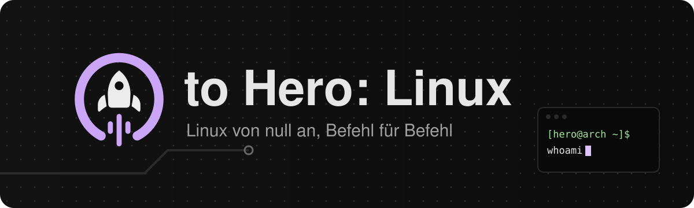

<p align="center">
  
</p>

<p align="center">
  <a href="https://r-winter-mute-dev.github.io/ZEROTOHERO-LINUX/"></a>
</p>

<p align="center">
  <a href="https://github.com/r-winter-mute-dev/ZEROTOHERO-LINUX/actions/workflows/deploy.yml"></a>
  <a href="https://github.com/r-winter-mute-dev/ZEROTOHERO-LINUX/actions/workflows/befehle.yml"></a>
  
  
  
  
</p>

<p align="center">
  <em>Diese Website wurde gebaut, um jedem Menschen die Möglichkeit zu geben, das System zu verstehen,<br>auf dem Webserver, Router und Supercomputer laufen: vom ersten Befehl bis zum eigenen, abgesicherten Server.</em>
</p>

---

**0 to Hero: Linux** ist ein kostenloser, interaktiver Linux-Kurs für alle, die bei null anfangen. Du lernst keine Befehlslisten auswendig. Du richtest von Anfang an ein echtes System ein, und jeder Befehl kommt genau dann, wenn du ihn brauchst.

Es ist der Schwesterkurs zu **[0 to Hero](https://github.com/r-winter-mute-dev/ZEROTOHERO)** (Elektronik) und funktioniert genauso.

Willkommen und viel Spaß beim Lernen.

## Kampagne 1: Dein eigener Server

> Am Ende läuft auf deinem **Debian** ein Server, den du komplett im Terminal eingerichtet hast: eine eigene **Statusseite**, ein **Backup**, das jede Nacht von allein startet, Anmeldung nur per **SSH-Schlüssel** und eine **Firewall**.

Der Weg dorthin beginnt mit `whoami`.

## So funktioniert der Kurs

| | |
| --- | --- |
| **Zehn Akte, ein Rack** | Jeder Akt füllt einen Einschub im Server-Rack. Auf der Startseite füllt es sich Einschub für Einschub. |
| **Kleine Schritte** | Eine Erklärung, ein Merksatz, eine kurze Frage. Ein Spickzettel steht immer daneben. |
| **Echte Prüfungen** | Quiz, Code-Puzzle, Terminal-Simulator oder ein **Nachweis**: Du führst einen Befehl in deinem echten Linux aus, und die Seite prüft die Ausgabe direkt im Browser. |
| **Bosskämpfe** | Am Ende jedes Akts wartet eine Fehlersuche: Etwas funktioniert nicht, und du findest anhand der Fehlermeldung heraus, warum. |
| **Auch ohne Linux** | Wer noch kein Linux hat oder nichts installieren darf, kommt im Terminal-Simulator weiter und holt die Nachweise später nach. |
| **Anpassbar** | Schriftgröße, Zeilenabstand, Bewegung und ein Fokusmodus lassen sich einstellen. |
| **Kein Konto, kein Tracking** | Der Fortschritt bleibt in deinem Browser und lässt sich als Code sichern oder übertragen. |

## Lehrplan

| Akt | Einschub | Du lernst | Stand |
| :---: | --- | --- | :---: |
| 0 | Rack | Sicherheit, Debian in WSL oder VM einrichten, das Terminal: Prompt, Befehl, Option, Argument, Tab, Fehlermeldungen lesen | ✅ |
| 1 | Festplatte | `pwd`, `ls`, `cd`, Pfade, Verzeichnisbaum, Dateien anlegen und sicher löschen, man-Pages und Doku lesen | 🛠️ |
| 2 | Werkzeugkasten | `cat`, `less`, `tail`, nano, Umleitungen, Pipes, `grep`, `find`, `sort`, `uniq`, reguläre Ausdrücke, `sed` und `awk` | 🛠️ |
| 3 | Schloss | Benutzer und Gruppen, rwx, `chmod`, `chown`, root und `sudo`, `PATH` | 🛠️ |
| 4 | Prozessor | Prozesse, `top`, Signale, Hintergrundjobs, Speicher und Platten, Umgebungsvariablen | 🛠️ |
| 5 | Lager | `apt`, Updates, fremde Paketquellen prüfen, Archive | 🛠️ |
| 6 | Netzwerkkarte | IP und DNS, Ports, `curl`, SSH und Schlüssel, `rsync` | 🛠️ |
| 7 | Steuerplatine | Shell-Skripte: Variablen, Quoting, Bedingungen, Schleifen, Funktionen, robuste Skripte. Ergebnis: dein Backup-Skript | 🛠️ |
| 8 | Wachturm | systemd, `journalctl`, eigene Dienste und Timer. Ergebnis: das Backup läuft jede Nacht | 🛠️ |
| 9 | Schutzschild | Automatische Sicherheitsupdates, Firewall, SSH härten, Statusseite, Finale | 🛠️ |

✅ spielbar · 🛠️ geplant, Missionen stehen fest

**Danach geplant:** Kampagne 2 *Arch von Hand*, der Hero-Schritt: Arch Linux ohne Installer, mit allem, was dazugehört. Kampagne 3 *Das Homelab*: Git, Container, Reverse Proxy, Monitoring.

## Warum Debian, und Arch erst später?

Anfänger lernen nachweislich besser mit klarer Anleitung und wenig Ballast, der nichts mit dem Lernziel zu tun hat. Fortgeschrittene profitieren dagegen von mehr Freiheit ([Kirschner, Sweller & Clark 2006](https://doi.org/10.1207/s15326985ep4102_1); Kalyuga et al. 2003, Expertise-Reversal-Effekt). Ob das für die Wahl einer Distribution gilt, ist nicht direkt untersucht. Es ist eine begründete Übertragung.

Daraus folgt der Aufbau: **Kampagne 1 nutzt Debian.** Jede Version bekommt etwa fünf Jahre lang Sicherheitsupdates, die Anleitungen bleiben also lange gültig. Der Installer richtet Benutzer und sudo selbst ein, und Debian läuft auf vielen echten Servern. **Kampagne 2 ist Arch Linux von Hand**: Wer die Grundlagen kann, baut sich dort jede Schicht selbst und pflegt ein Rolling Release.

Eine [GitHub Action](.github/workflows/befehle.yml) prüft jeden Monat die Befehle des Kurses in frischen Debian-Containern.

## Was du brauchst

Einen Rechner mit Windows 10/11, Linux oder macOS (auch mit Apple-Chip) und etwa 20 GB freien Speicher. Unter Windows reicht WSL, sonst eine virtuelle Maschine. Ohne eigenes Linux geht es im Simulator weiter. Die Übersicht steht im Kurs auf der Seite **Einrichtung**.

## Mitmachen

Fehler gefunden, eine Erklärung unverständlich oder Lust, eine Mission zu schreiben? Beiträge sind willkommen. Wie eine Mission aufgebaut ist und welche Bausteine es gibt, steht in [CONTRIBUTING.md](CONTRIBUTING.md).

Am meisten hilft gerade:

- [ ] **Akt 0 mit echtem WSL, VirtualBox und UTM durchspielen.** Stimmen die Schritte mit dem aktuellen Debian-Installer und dem WSL-Image überein?
- [ ] **Feedback von Einsteigern.** Wo bist du hängen geblieben?
- [ ] **Missionen für Akt 1 schreiben.** Der Simulator kann schon `cd`, `ls`, `mkdir`, `touch`, `cat` und Umleitungen.

## Entstehung

> [!NOTE]
> Dieser Kurs entsteht mit Unterstützung von **Claude**, einer KI von Anthropic. Die KI ist für dieses Projekt verändert und auf wissenschaftliches Arbeiten ausgelegt.

- **Belege zuerst:** Technische Angaben stützen sich auf die offizielle Dokumentation: man-Pages, Debian-Dokumentation, GNU-Handbücher. Foren, Blogs und soziale Medien gelten nicht als Beleg.
- **Kennzeichnung:** Angaben, die nicht geprüft werden konnten, sind im Kurs markiert.
- **Lernpsychologie:** Der Aufbau der Missionen (kurze Schritte, Merksätze, Fragen direkt nach jeder Erklärung, Spickzettel, wenig Ablenkung) folgt dem Elektronik-Kurs und damit der Forschung zu Arbeitsgedächtnis, Segmentierung und ADHS. Wo es keine direkte Studie zu einem Linux-Kurs gibt, ist das eine begründete Übertragung, kein Nachweis.

Die Idee, die Ziele und die Entscheidungen kommen von einem Menschen. Texte, Übungen und der Simulator stammen von der KI, ein Mensch prüft sie und gibt sie frei. Auch so können Fehler drinstecken. Wenn dir etwas falsch vorkommt, [öffne ein Issue](https://github.com/r-winter-mute-dev/ZEROTOHERO-LINUX/issues). Hinweise mit Quelle helfen am meisten.

## Für Entwickler

<details>
<summary><strong>Lokal starten</strong></summary>

Voraussetzung: Node.js 22.23.4 oder neuer (empfohlen: Node 24).

```bash
npm install
npm run dev
```

Die Seite läuft dann unter http://localhost:4321.
</details>

<details>
<summary><strong>Technik</strong></summary>

Statische Seite mit [Astro](https://astro.build) und MDX, ohne Server und ohne externe Dienste. Engine, Layout und Prüfungsbausteine stammen aus [0 to Hero](https://github.com/r-winter-mute-dev/ZEROTOHERO). Neu sind der Terminal-Simulator (`src/scripts/shell.ts`, `src/components/Terminal.astro`), der Terminal-Nachweis (`src/components/Nachweis.astro`) und das Rack (`src/components/Rack.astro`). Der Fortschritt liegt unter einem eigenen Schlüssel im Browser, weil beide Kurse unter derselben github.io-Adresse laufen. Die Seite wird über GitHub Actions automatisch auf GitHub Pages veröffentlicht.
</details>
