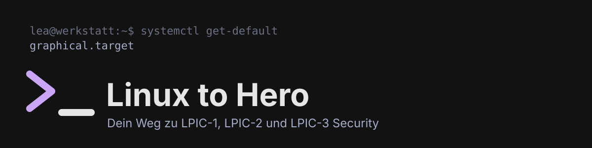

<p align="center">
  
</p>

<p align="center">
  <a href="https://r-winter-mute-dev.github.io/ZEROTOHERO-LINUX/"></a>
</p>

<p align="center">
  
  
  
  
</p>

<p align="center">
  <em>Ein kostenloser Kurs für alle, die Linux wirklich beherrschen wollen:<br>vom ersten Befehl bis zur Sicherheitszertifizierung.</em>
</p>

---

**Linux to Hero** bereitet auf die drei Linux-Zertifikate des Linux Professional Institute (LPI) vor: **LPIC-1**, **LPIC-2** und **LPIC-3 Security**. Du übst in einem simulierten Terminal direkt im Browser und auf deinem eigenen Linux, jede Mission endet mit einer Prüfung, und alles Gelernte kommt in wachsenden Abständen zurück, bis es sitzt.

## Die drei Kampagnen

| Kampagne | Zertifikat | Prüfungen | Lernziele | Stand |
| :---: | --- | --- | :---: | :---: |
| 1 | LPIC-1 Linux Administrator | 101-500, 102-500 | v5.0 | Prüfung 101 komplett spielbar (Akt 0 bis 4), Prüfung 102 ab Akt 5 im Aufbau |
| 2 | LPIC-2 Linux Engineer | 201-450, 202-450 | v4.5 | Lehrplan steht |
| 3 | LPIC-3 Security | 303-300 | v3.0 | Lehrplan steht |

Jede Prüfung hat 60 Fragen in 90 Minuten. Bestanden ist ab 500 auf einer Skala von 200 bis 800.

> [!NOTE]
> Für LPIC-2 gibt es im LPI-Wiki einen **Entwurf** der Version 5.0. Gültig ist weiterhin 4.5. Sobald das LPI 5.0 veröffentlicht, wird Kampagne 2 umgestellt.

### Kampagne 1: LPIC-1

| Akt | Topic | Inhalt | Stand |
| :---: | :---: | --- | :---: |
| 0 | – | Das Ziel und die Lernmethode, dein Labor mit zwei VMs, Überleben im Terminal | ✅ |
| 1 | 101 | Hardware (lspci, lsusb, /proc, /sys, /dev, udev), Kernelmodule, Bootvorgang, Kernelparameter, dmesg und journalctl, Runlevel und Targets, Herunterfahren, Bosskampf, Probeprüfung | ✅ |
| 2 | 102 | Partitionierung, GRUB, Shared Libraries, dpkg und apt, rpm, dnf und zypper, Linux als VM-Gast, Bosskampf, Probeprüfung | ✅ |
| 3 | 103 | Shell und Variablen, Verlauf und man, Textfilter, Dateien und Platzhalter, find und Archive, Umleitungen und Pipes, Prozesse, Jobs, Prioritäten, reguläre Ausdrücke, vi im Simulator, Bosskampf, Probeprüfung | ✅ |
| 4 | 104 | Partitionieren mit fdisk, Dateisysteme, mount und fstab, systemd-Mount-Units, fsck und tune2fs, Rechte und umask, SUID/SGID/Sticky, harte und symbolische Links, FHS und locate, Bosskampf, **Generalprobe 101** | ✅ |
| 5 | 105 | Variablen und Umgebung, Startdateien und /etc/skel, Aliase und Funktionen, das erste Skript, test und if/case, Schleifen und read, Bosskampf, Probeprüfung mit Interleaving | ✅ |
| 6 | 106 | X11 und Wayland, xorg.conf.d und Logs, xhost, xauth und ssh -X, Desktops und Display-Manager, VNC, RDP, Spice, XDMCP, Barrierefreiheit mit gsettings, Bosskampf | ✅ |
| 7 | 107 | Konten und Kontodateien, Gruppen und Passwortregeln, cron, at und systemd-Timer, Locales, iconv und Zeitzonen, Bosskampf, Probeprüfung 106 und 107 | ✅ |
| 8 | 108 | Systemuhr und Hardware-Uhr, NTP mit chrony und ntpd, rsyslog, Journal und logrotate, Mail-Aliase und ~/.forward, Drucken mit CUPS, Bosskampf, Probeprüfung | ✅ |
| 9 | 109 | IPv4, CIDR und Subnetting, Ports, TCP/UDP/ICMP und IPv6, dauerhafte Konfiguration mit NetworkManager und ifupdown, ip und net-tools, Fehlersuche mit ping, traceroute, tracepath, nc und ss, DNS mit host, dig und getent, Bosskampf, Probeprüfung | ✅ |
| 10 | 110 | Sicherheit, Generalprobe 102 | 📝 |

✅ spielbar · 📝 Lehrplan steht, Missionen folgen

## So funktioniert der Kurs

| | |
| --- | --- |
| **Kleine Schritte** | Eine Erklärung, ein Merksatz, sofort eine Frage. Ein Bildschirm pro Gedanke. |
| **Terminal im Browser** | Ein Simulator, der die Befehle aus den Missionen wie ein echtes System behandelt, inklusive Rechten, Pipes, Fehlermeldungen und Neustart. |
| **Eigenes Labor** | Aufgaben auf deiner eigenen VM. Ohne Labor geht es mit dem Simulator weiter. |
| **Wiederholen** | Karteikarten aus jeder Mission kommen nach 1, 3, 7, 14, 30 und 60 Tagen zurück, gemischt über alle Themen. Falsch beantwortete Prüfungsfragen auch. |
| **Probeprüfungen** | Zeitlimit wie in echt, gewichtet nach den offiziellen Lernzielen, Auswertung pro Lernziel. |
| **Bosskämpfe** | Fehlersuche anhand echter Meldungen: Ein System startet nicht, und du findest heraus, warum. |
| **Lernziel-Karte** | Zeigt pro Prüfung, wie viele der 60 Gewichtungspunkte du schon abgedeckt hast. |
| **Kein Konto, kein Tracking** | Fortschritt und Karten bleiben im Browser und lassen sich als Code sichern oder übertragen. |

## Warum so?

Die Methoden stützen sich auf Meta-Analysen der Lernforschung. Keine davon wurde mit Linux oder LPI-Prüfungen gemacht. Die Übertragung ist begründet, aber nicht nachgewiesen.

| Methode | Befund | Quelle |
| --- | --- | --- |
| Abrufen (Quizze) | g ≈ 0,50 in 222 Klassenzimmer-Studien | Yang et al. (2021), [doi:10.1037/bul0000309](https://doi.org/10.1037/bul0000309) |
| Verteiltes Abrufen | g = 0,74 gegenüber geballtem Abrufen. Wachsende Abstände nicht besser als gleiche (g = 0,03, n. s.) | Latimier et al. (2021), [doi:10.1007/s10648-020-09572-8](https://doi.org/10.1007/s10648-020-09572-8) |
| Mischen (Interleaving) | g = 0,42, stark heterogen (I² = 77 %), Vorsicht bei erklärenden Texten | Brunmair & Richter (2019), [doi:10.1037/bul0000209](https://doi.org/10.1037/bul0000209) |
| Segmentieren | kleine bis mittlere Effekte auf Behalten und Transfer, vor allem Multimedia | Rey et al. (2019), [doi:10.1007/s10648-018-9456-4](https://doi.org/10.1007/s10648-018-9456-4) |
| Lösungsbeispiele | mäßiger Effekt, nur Mathematik untersucht | Barbieri et al. (2023), [doi:10.1007/s10648-023-09745-1](https://doi.org/10.1007/s10648-023-09745-1) |

Fachliche Inhalte sind gegen die Handbuchseiten der Programme und die offiziellen Lernziele des LPI geprüft. Die Fragen sind selbst geschrieben, es sind keine echten Prüfungsfragen.

## Was du brauchst

- Einen Computer, der zwei virtuelle Maschinen schafft (VirtualBox, UTM auf Macs mit Apple-Chip, virt-manager oder GNOME Boxes unter Linux).
- Eine VM mit **Debian** und eine mit **AlmaLinux** oder **Rocky Linux**. Mission 0.2 führt durch die Einrichtung.
- Ab Kampagne 2: ein kleines virtuelles Netz aus drei VMs. Ab Kampagne 3: ein abgeschottetes Labornetz.

## Mitmachen

Fehler gefunden, eine Erklärung unverständlich oder Lust, eine Mission zu schreiben? Beiträge sind willkommen. Wie eine Mission aufgebaut ist und welche Bausteine es gibt, steht in [CONTRIBUTING.md](CONTRIBUTING.md).

Am meisten hilft gerade:

- [ ] **Feedback von Einsteigern.** Wo bist du hängen geblieben?
- [ ] **Prüfungserfahrung.** Wer die Prüfung abgelegt hat: Welche Themen kamen stärker dran als gedacht? (Bitte keine Prüfungsfragen weitergeben, das verbieten die Regeln des LPI.)
- [x] Topic 105 (Akt 5)
- [x] Topic 106 (Akt 6)
- [x] Topic 107 (Akt 7)
- [x] Topic 108 (Akt 8)
- [x] Topic 109 (Akt 9)
- [ ] **Missionen für Prüfung 102** (Topic 110 und Generalprobe).
- [ ] **Labor-Aufgaben testen** auf anderen Distributionen und mit anderen Virtualisierern.

## Entstehung

> [!NOTE]
> Dieser Kurs entsteht mit Unterstützung von **Claude**, einer KI von Anthropic.

Die Idee, die Ziele und die Entscheidungen kommen von einem Menschen. Texte, Übungen und Simulator schreibt die KI, ein Mensch prüft sie und gibt sie frei. Auch so können Fehler drinstecken. Wenn dir etwas falsch vorkommt, [öffne ein Issue](https://github.com/r-winter-mute-dev/ZEROTOHERO-LINUX/issues). Hinweise mit Quelle (Handbuchseite, Lernziel des LPI) helfen am meisten.

**Linux to Hero** ist ein unabhängiges Projekt und gehört nicht zum Linux Professional Institute. LPIC ist eine Marke des LPI.

## Für Entwickler

<details>
<summary><strong>Lokal starten</strong></summary>

Voraussetzung: Node.js 22 oder neuer.

```bash
npm install
npm run dev
```

Die Seite läuft dann unter http://localhost:4321.
</details>

<details>
<summary><strong>Technik</strong></summary>

Statische Seite mit [Astro](https://astro.build) und MDX, ohne Server und ohne externe Dienste. Aufgebaut auf der Lern-Engine von [ZEROTOHERO](https://github.com/r-winter-mute-dev/ZEROTOHERO).

| Pfad | Inhalt |
| --- | --- |
| `src/missionen/` | eine MDX-Datei pro Mission |
| `src/data/lernziele.ts` | offizielle Lernziele mit Gewichtung, mit Quelle |
| `src/data/kampagne.ts` | Kampagnen, Akte, Missionen, Ränge |
| `src/data/fragen.ts` | Fragenpool der Probeprüfungen |
| `src/scripts/shell.ts` | der Terminal-Simulator |
| `src/scripts/engine.ts` | Fortschritt, Punkte, Wiederholsystem, Export |
| `src/components/` | Prüfungsbausteine: Quiz, Terminal, Labor, Probe, Zuordnung, Reihenfolge, Lückentext, Logdiagnose |

Die Seite wird über GitHub Actions automatisch auf GitHub Pages veröffentlicht.
</details>

<details>
<summary><strong>Eigene Kopie betreiben</strong></summary>

Repository forken, unter **Settings → Pages** als Quelle **GitHub Actions** wählen, fertig. Der Workflow setzt den Pfad der Seite selbst.
</details>

## Lizenz

| Was | Lizenz |
| --- | --- |
| Inhalte (Missionen, Texte, Fragen) | [CC BY-SA 4.0](LICENSE-INHALTE.md): teilen und bearbeiten erlaubt, mit Quellenangabe und unter derselben Lizenz |
| Code | [MIT](LICENSE) |
| Schrift | Atkinson Hyperlegible, SIL Open Font License |
